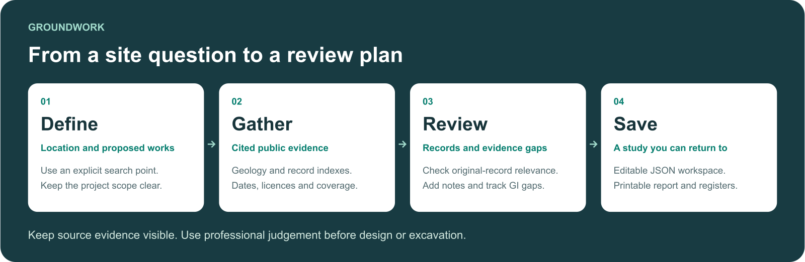
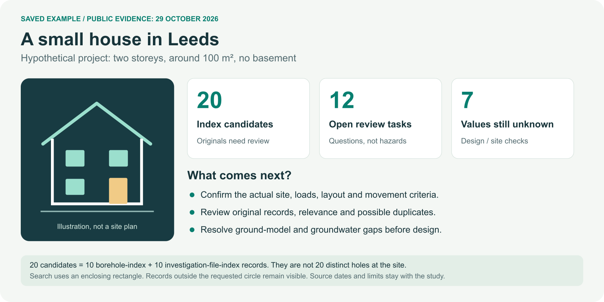

# Groundwork

**Explore UK ground data. Review the evidence. Plan what to investigate next.**

Groundwork is a free, open-source desk-study assistant and ground investigation
(GI) gap planner. It brings public records into one local workspace for
geotechnical engineers, architects, planners, students and people researching a site.

## What you can do

- Find published borehole and investigation-file index records, with source links.
- Gather regional geology, selected environmental records and planning context.
- Review record relevance, add notes and track unanswered GI questions.
- Save an editable study, printable report and CSV registers.

Runs on your computer. No provider API key or AI model is required. Results
need professional review before engineering design or excavation.

## Start in a few minutes

You need **Python 3.11 or newer** and internet access for the first setup.

1. [Download the project ZIP](https://github.com/cona8888/uk-data-mcp-servers/archive/refs/heads/main.zip) and extract it.
2. Open a terminal in the extracted `uk-data-mcp-servers-main` folder.
3. Run the command for your computer:

| Computer | Command |
|---|---|
| Windows | `py launch.py` |
| macOS / Linux | `python3 launch.py` |

The launcher installs the app in a local `.venv` folder and opens Groundwork in
your browser. Keep the terminal open; press **Ctrl+C** there to stop the app.
If a browser does not open, use the local address printed in the terminal.

Already have the project? Run the same command after updating it. The launcher
refreshes the installation when the application files change. See
[manual setup and troubleshooting](docs/QUICKSTART.md) if you need another route.

## Try a small example first

Choose **Explore Birmingham demo** to try the bundled example without live
provider calls. After installation, this saved example works offline.

Or [download the Leeds house study](https://raw.githubusercontent.com/cona8888/uk-data-mcp-servers/main/examples/leeds_small_house_example_2026-10-29.json)
and select **Open saved study** in Groundwork. If the link displays text, save
it as a `.json` file. Explore **Overview**, **Historic investigations**,
**GI gap register** and **Sources & provenance**, then choose **Save study JSON**.

This is a hypothetical project using public evidence retrieved on **29 October
2026**, not an identified development parcel. Candidates include results from an
enclosing search rectangle; they are not a count of distinct boreholes at the site.
Read the [validation findings](examples/leeds_small_house_validation_2026-10-29.json).

## Where does it work?

Coverage varies by source and UK nation. **England currently has the fullest
combined workflow.**

| Area | Groundwork includes now |
|---|---|
| England | Regional BGS geology, published investigation indexes, landslide records, EA monitoring and warnings, groundwater discovery and local planning authority |
| Scotland and Wales | Regional BGS geology and configured GB investigation / landslide indexes; national environment and planning adapters are planned |
| Northern Ireland | Regional BGS geology; investigation, environment and planning adapters remain to be added |

Archives are incomplete. Regional mapping and nearby records do not establish
site conditions. Detailed geology, site history, utilities, original-log review
and site investigation may still be needed. Fresh queries need internet access.
See [sources, coverage and data licences](docs/DATA_SOURCES.md).

## Want to go further?

| Goal | Read this |
|---|---|
| Run a study and review the GI gaps | [Groundwork guide](docs/GROUNDWORK.md) |
| Use an AI assistant or automate queries | [MCP, command line and Docker reference](docs/REFERENCE.md) |
| See an original-log desk-study example | [Birmingham draft report](docs/desk-studies/birmingham-draft-geotechnical-desk-study.pdf) |
| Check known issues and software validation | [Review notes](docs/REVIEW_FIXES.md) · [Leeds validation](examples/leeds_small_house_validation_2026-10-29.json) |
| Improve the project | [Contributing](CONTRIBUTING.md) · [Open an issue](https://github.com/cona8888/uk-data-mcp-servers/issues/new) |

**Code: MIT. Data: source-specific licences.** Groundwork is an independent
project. It is not an official BGS, Environment Agency or UK Government service.
