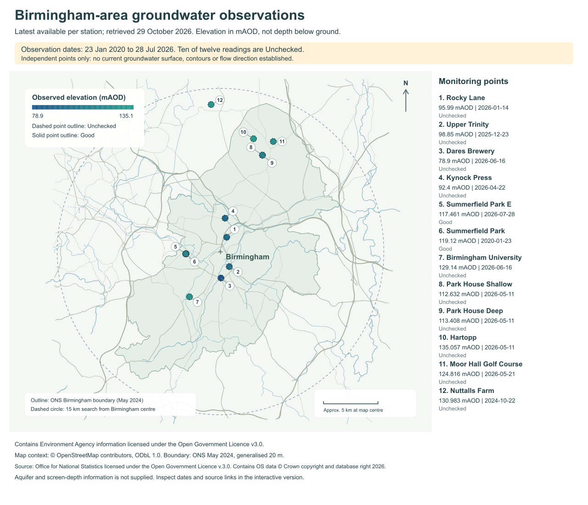

# Birmingham groundwater observation map

Explore **12 Environment Agency monitoring locations within 15 km of central
Birmingham**, retrieved through this repository's MCP on **29 October 2026**.



## Open the interactive map

1. Download [the standalone HTML](birmingham-groundwater-map.html). On GitHub,
   use **Download raw file**, or find it in your downloaded project ZIP.
2. Open the downloaded file in your browser. No installation is needed.
3. Select a numbered point or station name. Filter by observation age or quality.

The file works offline; source-station links need internet access. This is a
separate saved example, rather than a new panel in the Groundwork application.
The [PNG](birmingham-groundwater-map.png) and [SVG](birmingham-groundwater-preview.svg)
provide a shareable figure with source credits.

## What the map tells you

- Each point shows the latest available reading from that station's advertised
  series. Values range from **78.9 to 135.057 mAOD**: metres above Ordnance Datum.
- Observation dates range from **23 January 2020 to 28 July 2026**, making them
  **93 to 2,471 calendar days old** at retrieval. None is within the last 90 days.
- **10 readings are Unchecked; two are Good.** These are per-reading provider
  quality flags. Ten series are dipped and two are logged.
- Near-colocated records remain separate, including Park House Shallow/Deep and
  the two Summerfield records. Numbered callouts do not alter their coordinates.

These observations have different dates, methods and unverified aquifer/screen
contexts. They do **not** establish a current water table, groundwater contours,
flow direction, site groundwater depth or design groundwater level. Aquifer and
screen-depth information was not supplied. Surveyed site levels and appropriately
screened, contemporaneous monitoring would be needed for a site assessment.

## Evidence and coverage

The MCP calls were `hydrology_stations` and `hydrology_readings`. Discovery used
latitude **52.4862**, longitude **-1.8904**, radius **15 km**,
`observed_property="groundwaterLevel"`, and two pages of up to 50 candidates.
An explicit great-circle distance check retained 12 of 65 distinct station URIs;
53 returned candidates lay outside the circle. This is a bounded extract, not a
complete inventory of wells or groundwater conditions.

Each retained station advertised one series. All 12 reading calls used `limit=1`.
All **26 HTTP responses** succeeded. Requested and returned measure identities,
reading-measure identity, station URI, `GroundwaterLevel` type and `mAOD` units
were checked before plotting. Source timestamps are retained as supplied; they
have no explicit time-zone suffix. Ages use calendar dates.

| File | Contents |
|---|---|
| [Groundwater GeoJSON](../../examples/maps/birmingham_groundwater_2026-10-29.geojson) | Twelve points, values, dates, quality, methods, identities and source links |
| [MCP evidence](../../examples/maps/birmingham_groundwater_evidence_2026-10-29.json) | Original MCP result envelopes, request trace, coverage and basemap source metadata |
| [ONS boundary](../../examples/maps/birmingham_ons_boundary_2024.geojson) | Birmingham boundary, May 2024, generalised to 20 m |
| [Compressed OSM context](../../examples/maps/birmingham_osm_context_2026-10-29.geojson.gz) | Machine-readable selected roads, rivers and canals used by the map |

The map combines the published coordinates of monitoring stations, the ONS
boundary and OpenStreetMap ways. Web Mercator is used for display; the scale bar
is approximate at the search centre. Roads and waterways provide geographic
context and do not establish groundwater connections.

## Rebuild the saved example

From the project root, run Python 3.11 or newer:

```text
python scripts/build_birmingham_groundwater_map.py
```

This uses the retained evidence without network requests and writes the HTML,
the publication SVG and a local copy under `output/html/`. The PNG is rendered
from `birmingham-groundwater-preview.svg` using an SVG-to-PNG renderer; it is
not regenerated by the Python script. A fresh provider query is needed to
update the observations. Rebuilding this snapshot does not refresh its dates.

## Data licences and credits

**Groundwater:** Contains Environment Agency information licensed under the
[Open Government Licence v3.0](https://www.nationalarchives.gov.uk/doc/open-government-licence/version/3/).
See the [EA Hydrology API reference](https://environment.data.gov.uk/hydrology/doc/reference).

**Boundary:** Source: Office for National Statistics licensed under the Open
Government Licence v.3.0. Contains OS data © Crown copyright and database right
2026. The boundary is the May 2024 ONS local authority dataset, rather than a
surveyed site boundary. See [ONS geography licences](https://www.ons.gov.uk/methodology/geography/licences).

**Roads and waterways:** [© OpenStreetMap contributors](https://www.openstreetmap.org/copyright),
[ODbL 1.0](https://opendatacommons.org/licenses/odbl/1-0/). The filtered OSM layer
used here is available in the compressed GeoJSON above. Its source database time
is 29 October 2026, 13:10:27 UTC. Keep these credits with reused figures.

Code is MIT licensed. Provider layers retain their separate licences; neither
the MIT code licence nor the OSM licence replaces the EA or ONS terms.

The [validation record](birmingham-groundwater-checks-2026-10-29.json) records
the source checks, interaction checks, visual review and file hashes. Browser
rendering was not tested.
